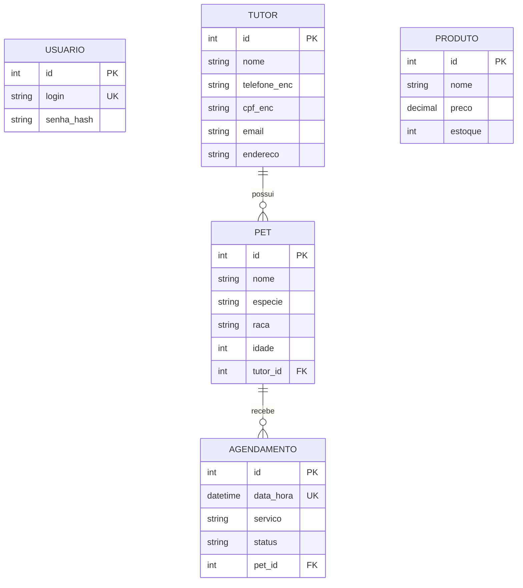

# Sistema de Gestão para Pet Shop

Aplicação em Java com persistência em MySQL, desenvolvida para o controlo de tutores, pets, produtos e agendamentos de serviços de banho e tosa. O sistema prioriza a segurança da informação através de criptografia de dados pessoais, hashing de palavras-passe e encerramento automático de sessão por inatividade.

---

## 🛠️ Pré-requisitos

- **Java Development Kit (JDK):** Versão 17 ou superior.
- **MySQL Server:** Versão 8.0 ou superior.
- **MySQL Connector/J:** Driver JDBC (`mysql-connector-j-8.x.x.jar`).
- **IDE Recomendada:** IntelliJ IDEA, Eclipse ou VS Code.

---

## 📊 Diagrama Entidade-Relacionamento (DER)

### Representação Gráfica (Mermaid)



### Relacionamentos e Restrições
- **`USUARIO`**: Controlo de acessos. O campo `login` possui restrição de unicidade (`UNIQUE`).
- **`TUTOR` $\rightarrow$ `PET`**: Relacionamento $1 : N$ (Um tutor pode possuir vários pets).
- **`PET` $\rightarrow$ `AGENDAMENTO`**: Relacionamento $1 : N$ (Um pet pode ter múltiplos agendamentos).
- **`AGENDAMENTO`**: O campo `data_hora` possui restrição `UNIQUE` para impedir marcações duplicadas no mesmo horário.
- **Criptografia**: Os campos `cpf_enc` e `telefone_enc` na tabela `TUTOR` são gravados em formato cifrado (AES).

---

## 🚀 Instruções de Configuração e Execução

### 1. Configurar o Banco de Dados MySQL
Aceda ao seu cliente MySQL (MySQL Workbench, DBeaver ou CLI) e execute o script contido em `schema.sql`:

```sql
CREATE DATABASE IF NOT EXISTS petshop;
USE petshop;

CREATE TABLE usuario (
    id INT AUTO_INCREMENT PRIMARY KEY,
    login VARCHAR(50) UNIQUE NOT NULL,
    senha_hash VARCHAR(255) NOT NULL
);

CREATE TABLE tutor (
    id INT AUTO_INCREMENT PRIMARY KEY,
    nome VARCHAR(100) NOT NULL,
    telefone_enc VARCHAR(255) NOT NULL,
    cpf_enc VARCHAR(255) NOT NULL,
    email VARCHAR(100),
    endereco VARCHAR(200)
);

CREATE TABLE pet (
    id INT AUTO_INCREMENT PRIMARY KEY,
    nome VARCHAR(100) NOT NULL,
    especie VARCHAR(50),
    raca VARCHAR(50),
    idade INT,
    tutor_id INT,
    FOREIGN KEY (tutor_id) REFERENCES tutor(id) ON DELETE CASCADE
);

CREATE TABLE produto (
    id INT AUTO_INCREMENT PRIMARY KEY,
    nome VARCHAR(100) NOT NULL,
    preco DECIMAL(10,2) NOT NULL,
    estoque INT NOT NULL
);

CREATE TABLE agendamento (
    id INT AUTO_INCREMENT PRIMARY KEY,
    data_hora DATETIME UNIQUE NOT NULL,
    servico VARCHAR(50) NOT NULL,
    status VARCHAR(20) DEFAULT 'agendado',
    pet_id INT,
    FOREIGN KEY (pet_id) REFERENCES pet(id) ON DELETE CASCADE
);
```

---

### 2. Execução via IntelliJ IDEA

1. **Abrir o Projeto:**
   - Abra o IntelliJ IDEA e selecione a pasta do projeto.
2. **Adicionar o Driver JDBC do MySQL:**
   - Vá a **File** > **Project Structure** > **Modules** > separador **Dependencies**.
   - Clique no ícone **`+`** > **JARs or Directories...**.
   - Selecione o ficheiro `.jar` do MySQL Connector descarregado e clique em **Apply**.
3. **Definir a Variável de Ambiente (`AES_KEY`):**
   - No canto superior direito, clique no menu de configurações de execução e selecione **Edit Configurations...**.
   - No campo **Environment variables**, insira: `AES_KEY=Chave16BytesAtend!`.
   - Clique em **Apply** e **OK**.
4. **Executar a Aplicação:**
   - Abra o ficheiro `PetShopApp.java` e clique no botão verde de **Run** ($\triangleright$).

---

### 3. Execução via Terminal / Linha de Comandos

Coloque o ficheiro `PetShopApp.java` e o driver do MySQL na mesma pasta.

#### Windows (PowerShell)
```powershell
$env:AES_KEY="Chave16BytesAtend!"
javac PetShopApp.java
java -cp ".;mysql-connector-j-8.3.0.jar" PetShopApp
```

#### Linux / macOS
```bash
export AES_KEY="Chave16BytesAtend!"
javac PetShopApp.java
java -cp .:mysql-connector-j-8.3.0.jar PetShopApp
```
